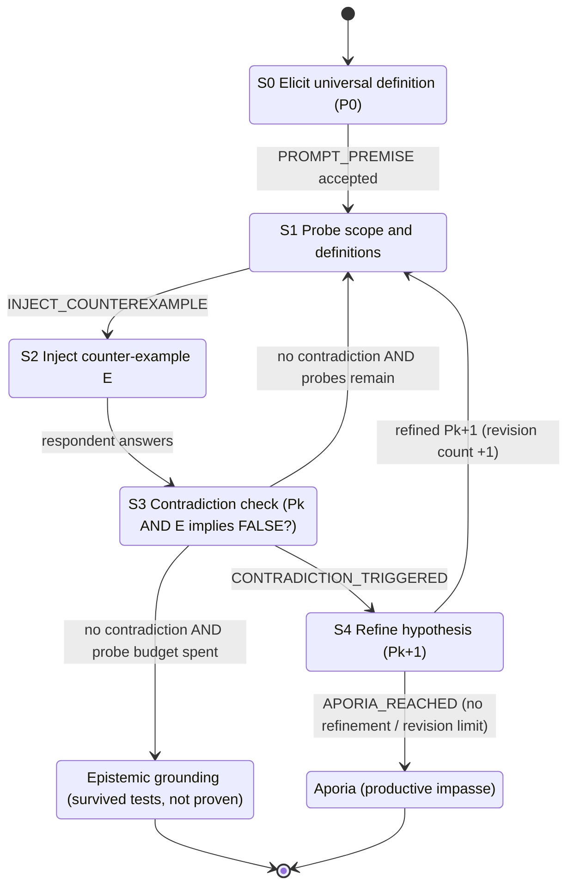

# 02 Socratic Protocol Map (Elenchus)

**Station role:** Protocol Officer

## 1. State diagram (course states S0-S4 plus halting states)



## 2. JSON-RPC 2.0 transition messages

All messages use `"jsonrpc": "2.0"`. State changes are requests/notifications whose `method` is the state marker.

| Marker (method) | Direction | Kind | Params |
|---|---|---|---|
| `PROMPT_PREMISE` | engine to respondent | request | `{topic, turn}` |
| `INJECT_COUNTEREXAMPLE` | engine to respondent | request | `{definition, counterexample, turn}` |
| `CONTRADICTION_TRIGGERED` | judge to engine | notification | `{a, b}` verbatim conflicting commitments |
| `APORIA_REACHED` | engine to log | notification | `{reason, revisions}` |

Example:
```json
{"jsonrpc":"2.0","id":3,"method":"INJECT_COUNTEREXAMPLE",
 "params":{"definition":"Fair means identical treatment for all",
           "counterexample":"A wheelchair user faces stairs","turn":3}}
```

## 3. Error codes

Codes -32700 to -32600 are standard JSON-RPC. -32001 to -32005 are custom, in the implementation-defined range -32000 to -32099.

| Code | Name | Meaning | Engine response |
|---|---|---|---|
| -32700 | Parse error | Judge returned non-JSON | Treat as "no contradiction found" and log it |
| -32600 | Invalid request | Malformed message | Reject, log |
| -32601 | Method not found | Unknown state marker | Reject, log |
| -32602 | Invalid params | Missing `definition` etc. | Reject, log |
| -32603 | Internal error | Unexpected engine fault | Abort run |
| -32001 | PROBE_BUDGET_EXHAUSTED | `max_probes` reached with no contradiction | Go to GROUNDED |
| -32002 | REVISION_LIMIT_REACHED | `max_revisions` reached | Go to APORIA |
| -32003 | QUESTIONER_ASSERTION_VIOLATION | Questioner output not a question or asserted a conclusion | Replace with fallback question, log |
| -32004 | RESPONDENT_REFUSED | Respondent said "I do not know" or gave no revision | Go to APORIA |
| -32005 | BACKEND_UNAVAILABLE | LLM API call failed or key missing | Abort run with clear error |

## 4. Aporia stopping criteria

Enter APORIA when any of these holds:
1. `revisions >= max_revisions` (default 3) and the definition is still contradicted.
2. The respondent says it does not know, or declines to revise after a contradiction.
3. No refinement can be produced that avoids the conflicting pair.

Enter GROUNDED when `probes >= max_probes` (default 3) with no contradiction. GROUNDED means "survived these tests", not "true".

## 5. Implementation status (honest note)

`socratic.py` (this folder) implements the state logic, budgets, the questioner guard (-32003 behaviour) and the apology-free APORIA path. It does **not** currently exchange real JSON-RPC envelopes or return numeric error codes; the table above is the specification for that layer. The offline trace in this folder (`traces/socratic_mock.md` and `.json`) shows the run: one contradiction, one revision, then GROUNDED.

## 6. Files in this folder
| File | Purpose |
|---|---|
| `02_Socratic_Protocol_Map.md` | This protocol map |
| `socratic.py` | Elenchus state machine (states, budgets, questioner guard, judge call) |
| `mock_socratic.py` | Offline scripted respondent/questioner and keyword-rule judge |
| `tests/test_socratic.py` | 4 unit tests |
| `traces/socratic_mock.md`, `.json` | Output of the offline Socratic run |
